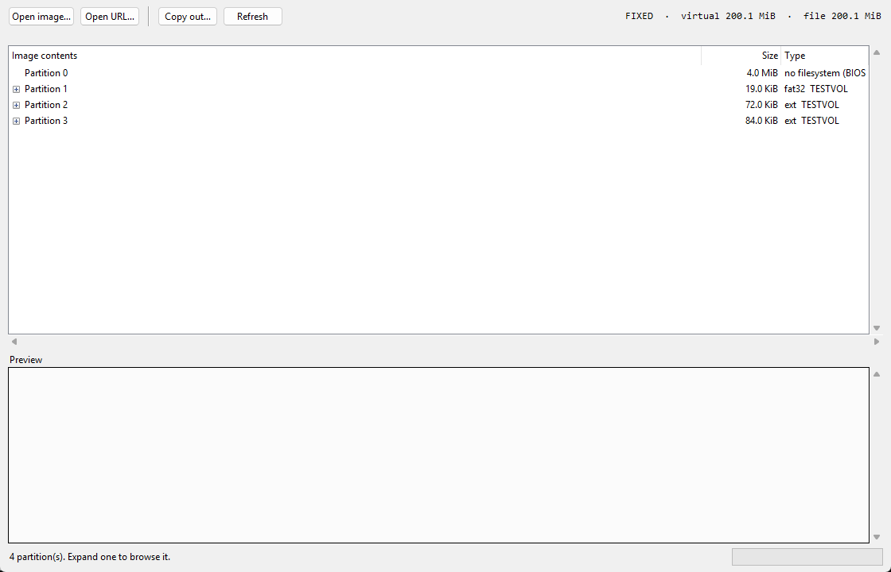
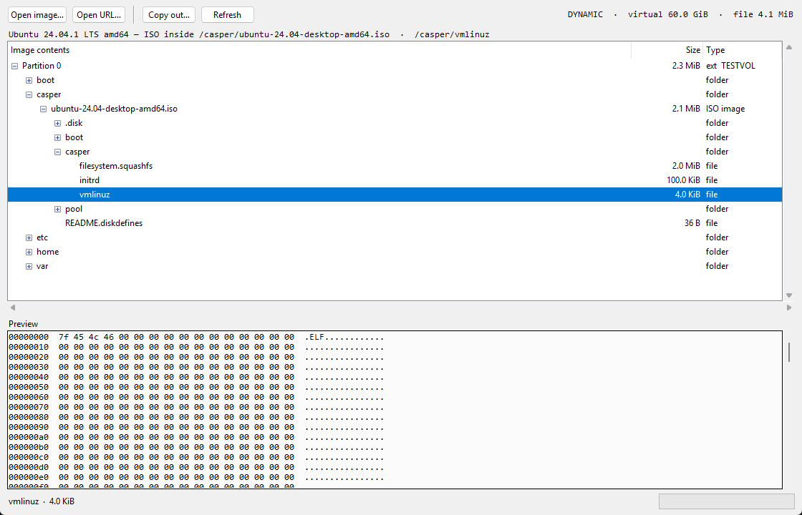

[](../../actions/workflows/tests.yml)
[](https://www.python.org/downloads/)
[](../../actions/workflows/build-exe.yml)
[](LICENSE)
[](#supported-formats)

Browse a VHD/VHDX disk image over HTTP or from a local file — no download, no
mount. Walks partitions and filesystems, and enters an ISO that lives *inside*
the image without extracting it.

## Install

### Portable Windows exe

From the [releases page](../../releases), take either
`vhdpeek-<version>-windows-x64.exe` and run it, or the `.zip` and unzip it
somewhere permanent. There is one binary, `vhdpeek.exe`: double-click it to
open the window, or drag an image onto it.

The exe is self-contained - no installer, no registry, no files left behind.
Delete it to uninstall. Builds come from
[`.github/workflows/build-exe.yml`](.github/workflows/build-exe.yml) on every
tagged release, and each one is started against a real image before it is
attached.

```
vhdpeek.exe
vhdpeek.exe D:\images\ubuntu.vhd
```


### Linux and macOS

One line, no clone:

```bash
curl -fsSL https://raw.githubusercontent.com/ayomidelog/vhdpeek/main/install.sh | sh
```

That installs into a private virtual environment under
`~/.local/share/vhdpeek` and links the `vhdpeek` command into `~/.local/bin`;
nothing else on the system is touched. Undo it with the same
script:

```bash
curl -fsSL https://raw.githubusercontent.com/ayomidelog/vhdpeek/main/install.sh \
    | sh -s -- --uninstall
```


## CLI

```bash
vhdpeek disk.vhd --parts        # what is inside?
vhdpeek disk.vhd                # walk the tree (default action)
vhdpeek disk.vhd --ls /var/log  # list one directory
vhdpeek disk.vhd --cat /etc/os-release

# Over HTTP — only the needed ranges are fetched
vhdpeek https://example.com/disk.vhdx --max-depth 2

# Enter an ISO stored inside the image's filesystem
vhdpeek ubuntu.vhd --iso /casper/ubuntu-24.04-desktop-amd64.iso --ls /
vhdpeek ubuntu.vhd --iso /casper/ubuntu-24.04-desktop-amd64.iso \
    --cat /casper/initrd > initrd
```

Every command also runs as `python -m vhdpeek ...` from a checkout, with
nothing installed.

| Flag | Meaning |
|---|---|
| `--parts` | list partitions and stop |
| `--part N` | partition index (default: first with a recognisable filesystem) |
| `--tree` | print the directory tree (the default) |
| `--max-depth N` | tree depth limit (default 3) |
| `--ls PATH` | list one directory |
| `--cat PATH` | stream a file to stdout |
| `--iso PATH` | mount an ISO stored inside the filesystem |
| `--fs KIND` | override detection: `auto`, `ntfs`, `fat`, `ext`, `iso` |
| `--gui` | open the graphical browser |
| `--theme` | GUI scheme: `dark` or `light` (default: follow the system) |

Diagnostics go to stderr, so `--cat` output is byte-exact and safe to pipe into
`sha256sum`, `tar`, or `qemu-system-x86_64 -kernel`.

### When it cannot open the image

A wrong path, an unreachable host and a 404 are reported as such, with a hint
and a distinct exit code — no traceback:

```
$ vhdpeek /tmp/nope.vhd --parts
error: no such file: /tmp/nope.vhd
hint:  check the path, or pass an http(s) URL instead
$ echo $?
2
```

| Exit | Meaning |
|---|---|
| 0 | success |
| 1 | the image opened, but the request could not be satisfied (no such partition, unrecognised filesystem) |
| 2 | the image could not be read: bad path, bad URL, unreachable host, HTTP error, not a VHD/VHDX |

The message distinguishes the cases that are easy to confuse: a refused
connection is `cannot reach <host>`, not "the server did not report a size";
a 403 says access was denied, a 404 says the path does not exist. The GUI
shows the same text in its status bar.

## GUI

```bash
vhdpeek --gui                          # then open an image
vhdpeek --gui disk.vhd                 # or start with one
vhdpeek --gui disk.vhd --theme dark    # force a scheme
```

An explorer. It opens on the image's partitions and stays there:



- **An ISO is a file, not a destination.** Expand the `.iso` and its contents
  appear underneath it, in place, so the on-disk structure stays visible. The
  partition above is untouched — collapse the ISO to go back.
- **Copy out.** Select a file or folder and **Copy out…**. Folders are copied
  recursively, keeping their structure, with progress and a cancel button.
  Works for anything reachable, including files inside a mounted ISO.
- **Preview.** Text renders as text, anything else as a hex dump; the first
  64 KiB is read.
- **Lazy.** A directory is only read when you expand it, so opening a 60 GiB
  image costs a handful of requests rather than a full walk.
- **Nothing blocks.** All filesystem work runs on one background thread, so a
  100 ms round trip never freezes the window.
- **Light and dark.** Follows the desktop's preference on first run, then
  remembers what you pick with **Theme** (`Ctrl+T`). Dialogs are centred over
  the window that raised them.



| Key | Action |
|---|---|
| `Ctrl+O` | open a file |
| `Ctrl+U` | open a URL |
| `Ctrl+E` | copy out |
| `F5` | reload |
| `Ctrl+T` | switch light/dark |
| `Esc` | cancel a running copy |

## Sparse mapping

`VHDInfo.read` maps a virtual offset to a file offset, coalescing contiguous
runs so one run becomes one HTTP request:

| Container | Mapping |
|---|---|
| fixed VHD | offset used directly; footer at end |
| dynamic / differencing | BAT entry per 2 MiB block, skipping the block's 512-byte sector bitmap; `0xFFFFFFFF` = hole |
| VHDX | BAT entry per 1 MiB block; state in bits 0–2, file offset in MiB in bits 20–63 |

Holes and the tail past the virtual size read as zeros, so the layers above
never see a short read. The BAT is read a 4 KiB page at a time, so a 60 GiB
dynamic disk with a large BAT is never loaded wholesale.

## Supported formats

| Layer | Format | Detail |
|---|---|---|
| Container | VHD fixed | data at offset 0, footer at end |
| | VHD dynamic / differencing | `cxsparse` header, BAT, sector bitmaps |
| | VHDX | region table, metadata region, BAT; 512/4096 logical sectors |
| Partition | MBR | four primaries plus the extended/logical EBR chain |
| | GPT | protective MBR, header at LBA 1, 128-byte entries |
| Filesystem | FAT12/16/32 | BPB, on-demand FAT (64-sector LRU), LFN, 8.3 case flags, FAT12 nibbles |
| | NTFS | `$MFT` with runlists and `$ATTRIBUTE_LIST`, resident/non-resident `$DATA`, `$I30` B-tree, LZNT1 |
| | ext2/3/4 | extent trees, 64-bit group descriptors, filetype dirs |
| | ISO 9660 | PVD, Joliet, Rock Ridge (SUSP incl. `CE`/`CL`/`RE`/`SK`), multi-extent files |

Differencing disks and VHDX files with a parent are detected and reported
(`has_parent`, `parent_name`), but the parent chain is **not** resolved: a
block that lives in the parent reads as zeros. A VHDX whose log is not empty
sets `is_dirty`, and the CLI warns — the log is not replayed.

## Performance

Measured on Windows, Python 3.14. `tools/bench.py` reproduces all of it.

**Parse cost** — open the image, read the partition table, mount the
filesystem, list the root directory:

| Image | Time |
|---|---|
| fixed VHD | 0.44 ms |
| dynamic VHD | 0.48 ms |
| VHDX | 0.71 ms |
| FAT12 / FAT16 / FAT32 | 0.44 – 0.67 ms |
| NTFS | 0.49 ms |
| ext4 | 0.45 ms |
| ISO 9660 | 0.48 ms |

**Bulk read**, local file, 4 MiB:

| Filesystem | Throughput |
|---|---|
| ISO 9660 | 3.1 GiB/s |
| ext4 | 791 MiB/s |
| NTFS | 785 MiB/s |
| FAT32 | 138 MiB/s (512-byte clusters, one lookup per cluster) |

**Over HTTP**, 60 GiB sparse VHD with an ISO inside it. Only the ranges each
operation needs are fetched; nothing is downloaded up front:

| Operation | Requests | Bytes fetched | Time |
|---|---|---|---|
| open + list `/` | 6 | 159 KB | 16 ms |
| enter the nested ISO | 2 | 64 KB | 6 ms |
| read a 2 MiB file from that ISO | 3 | 2.08 MB | 25 ms |

Request count is what a real network charges for, so the block cache trades
round trips against over-fetched bytes. `BLOCK_SIZE` (32 KiB) was picked by
measuring that tradeoff across link profiles from LAN to mobile: raising it
reduces requests but multiplies bytes.

### Verified against a real Azure blob

A 64 GiB Ubuntu 24.04.5 cloud image (`PageBlob`, GPT, SAS-token URL) was
browsed without downloading it. Session total: **23 requests, 0.92 MiB** out of
68,719,477,248 bytes — 0.0014% of the image, in 3.2 s (141 ms mean round-trip
to Azure).

| Operation | Requests | Bytes |
|---|---|---|
| open + parse GPT + mount ext4 + list `/` | 5 | 160 KiB |
| read `/etc/os-release` (needed `/etc`, a multi-block dir) | 11 | 352 KiB |
| read `/etc/hostname` (7 B) | 1 | 32 KiB |
| resolve symlink `/vmlinuz` and read 64 B | 2 | 64 KiB |
| 1 MiB slice at offset 8 MiB of a 17 MB kernel | 1 | 1 MiB |

Azure Blob serves `Range` on page blobs, so SAS-token URLs work directly.
Round-trip latency, not bandwidth, dominates: a depth-2 walk of that filesystem
cost 107 requests and 12.5 s while fetching only 3.5 MB.

## Limits

- No writes; no NTFS compression beyond LZNT1; no EFS decryption.
- Only the unnamed `$DATA` stream is exposed — alternate data streams are not.
- FAT volume labels are read, but exFAT is rejected.
- A VHDX that needs log replay may read stale data.
- No hybrid MBR handling, no APFS, no LVM, no dm-crypt.
- The HTTP server must support `Range`. If it ignores the header, reads near
  the start still work, but a late offset raises `RangeNotSupported` rather
  than downloading everything before it.

## Tests

```bash
pip install -r requirements-dev.txt
python -m pytest tests -q
```

296 tests. Fixture images are generated from the published on-disk layouts
(`tests/fixtures/`), not by the code under test, and `TestGenerators`
re-validates those bytes with independent third-party readers.

The GUI tests drive real Tk widgets and skip when no display is available. On
a headless machine:

```bash
xvfb-run -a python -m pytest tests -q
```

Regenerate the sample images in `test_data/` with
`python tools/make_test_images.py`. CI runs the suite on Python 3.9 – 3.13
across Linux, macOS and Windows, plus a CLI smoke test.


## Contributing

Contributions are welcome — see [CONTRIBUTING.md](CONTRIBUTING.md) for setup
and the two rules that matter:

- **A bug fix gets a test that fails before it.** Reproduce first.
- **Fixtures come from the spec, not from the reader.** Parsing bytes you just
  wrote proves nothing.

Report security issues through [SECURITY.md](SECURITY.md) rather than the
issue tracker.


## By [ayomidelog](https://github.com/ayomidelog)
